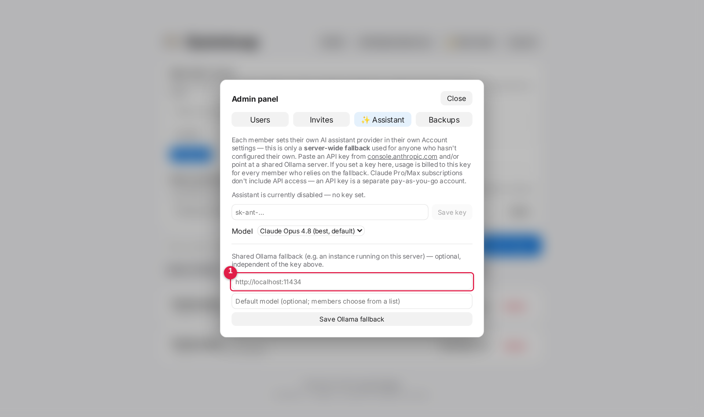
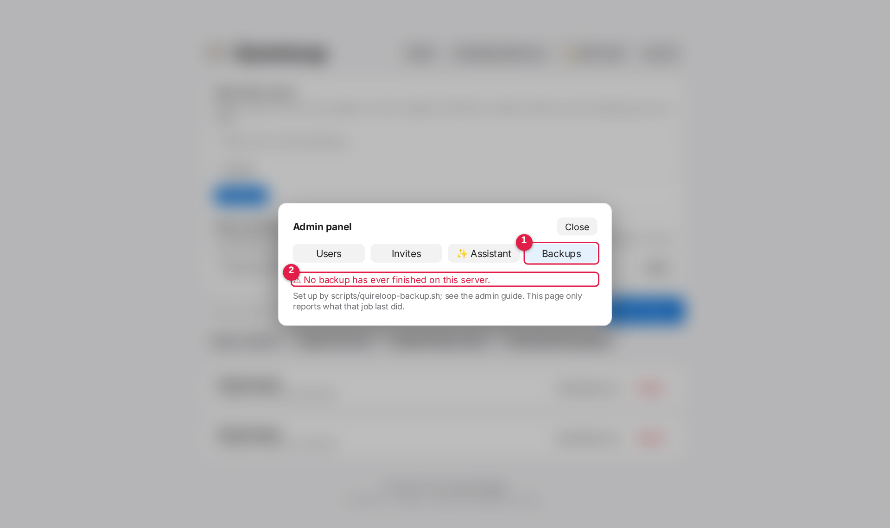

# Quireloop admin guide

For the person running a Quireloop server. Installing is covered in
[Install on a server](install-server.md); this guide is everything after that.
Members need only the [user guide](user-guide.md).

## Contents

1. [The first hour](#the-first-hour)
2. [Accounts and sign-in](#accounts-and-sign-in)
3. [AI models](#ai-models)
4. [Grammar check](#grammar-check)
5. [Backups](#backups)
6. [Recovering from a disaster](#recovering-from-a-disaster)
7. [Updating](#updating)
8. [Troubleshooting](#troubleshooting)

## The first hour

1. Install with [Install on a server](install-server.md), behind HTTPS.
2. Create the first account. It becomes the admin.
3. [Turn on backups](#backups) before anyone relies on the server.
4. [Set up AI models](#ai-models) and [grammar check](#grammar-check) if you
   want them.
5. Invite your members from **Admin → Invites**, or use
   [server logins](install-server.md#logging-in-with-server-accounts).

## Accounts and sign-in

A browser stays signed in for 30 days after it was last used. Change this with
`QUIRELOOP_SESSION_DAYS`. Deleting the `session-key` file in the data folder
signs **everyone** out at once, so use it only if you suspect a stolen session.
Disabling an account in **Admin → Users** takes effect on that person's next
click.

## AI models

To give everyone your local models, open **Admin → ✨ Assistant** and enter the
Ollama address.



Put the address in the box marked 1 and save. A model name below it is optional.
Every member then sees the installed models in a dropdown, with no setup of
their own, and models you install later appear by themselves. Members can still
choose their own API key instead, in their account settings.

Ollama must be reachable from the Quireloop service. If it listens on a port
other than 11434, use that port.

Subscriptions can't be connected: OpenAI lets only approved partner apps use
ChatGPT plans, and Claude and Gemini plans are limited to their own apps. The
user guide explains the copy-and-open buttons that are offered instead.

## Grammar check

Grammar check uses LanguageTool, a free open-source checker, on your own server,
so text never leaves it. It needs Java 17 or newer and about 1.5 GB of memory.

```bash
sudo bash scripts/install-languagetool.sh
```

**Grammar check** then appears in each project's **Edit** menu. Members turn it
on for themselves. To stop it:

```bash
sudo systemctl disable --now languagetool
```

There is no way to connect a commercial grammar service: the main ones don't
offer a public interface for other editors. Members with such a subscription can
use **Edit → Copy text without LaTeX** and paste into that app.

## Backups

No single copy is safe. Use all three layers, because each covers what the
others can't:

| Layer | Survives | Doesn't survive | Who sets it up |
|---|---|---|---|
| Copy every 10 minutes on another disk | Disk or array failure, deleted files, bad updates | Theft, fire, someone with root on the server | Admin |
| Off-site copy with rclone | All of the above, and losing the machine | Losing the cloud account | Admin |
| Copy on each laptop | All of the above, including a hacked server | Only covers that person's papers | Each member |

### Copies every 10 minutes

**1. Prepare a disk.** It must be a different physical disk from the data. The
script refuses otherwise, and refuses if the disk isn't mounted.

**2. Configure.**

```bash
sudo mkdir -p /etc/quireloop
sudo cp deploy/quireloop-backup.env.example /etc/quireloop/backup.env
sudo chmod 600 /etc/quireloop/backup.env
sudoedit /etc/quireloop/backup.env
```

**3. Turn on the timer.** Check the path in the service file first.

```bash
sudo cp deploy/quireloop-backup.service.example /etc/systemd/system/quireloop-backup.service
sudo cp deploy/quireloop-backup.timer.example /etc/systemd/system/quireloop-backup.timer
sudo systemctl daemon-reload
sudo systemctl enable --now quireloop-backup.timer
```

**4. Run the first one, and look at it.**

```bash
sudo systemctl start quireloop-backup.service
sudo ls -l /mnt/backup/quireloop
```

Every 10 minutes makes a folder named by date and time, such as
`2026-11-03_0350`, even when nothing changed. Each is a complete copy, but
unchanged files share disk space, so it costs only what changed. Kept: every
copy from the last 24 hours, the last copy of each of the last 14 days, and the
first copy of each of the last six months. `KEEP_RECENT_HOURS`, `KEEP_DAILY`
and `KEEP_MONTHLY` in `backup.env` change these.

**5. Keep an eye on it.** **Admin → Backups** shows the last run and turns red
after an hour without one.



Press the **Backups** tab (1) and read the status (2). The picture shows a server
with no backups yet.

These folders hold `users.json`, with password hashes and members' API keys, and
`session-key`. The script keeps them readable by root only. Treat the disk as
carefully as the server.

### Off-site copy

rclone can send the papers to OneDrive, Dropbox, Google Drive and many others.
Only `projects/` goes, never accounts or keys, and what's deleted here isn't
deleted there.

```bash
sudo rclone config
```

Create a remote for your cloud account, then a second remote of type **crypt**
on top of it, so the cloud company can't read unpublished papers. **Keep the crypt
password somewhere off this server**: without it the copy can't be read. Then
add the crypt remote to `/etc/quireloop/backup.env`:

```bash
RCLONE_REMOTE=onedrive-crypt:quireloop
```

Check your institution's rules on storing research data in a personal cloud.

### Copy to a laptop with rsync

To pull a server backup to your own machine:

```bash
rsync -a --rsync-path="sudo rsync" you@server:/mnt/backup/quireloop/latest-date/ ~/quireloop-backup/
```

Replace `latest-date` with a dated folder. Keep the result encrypted, as it
contains the same secrets.

### Practise a restore

A backup you've never restored is a hope, not a backup. Every few months:

```bash
sudo diff -r /mnt/backup/quireloop/DATE/projects /var/lib/quireloop/data/projects | head
```

Then copy one paper to a test Quireloop and compile it.

## Recovering from a disaster

**One paper was damaged or deleted.** Use version history first. Failing that,
copy its folder back from a dated backup into the same place under `projects/`,
then fix ownership.

**The server's disk is lost.** Install Quireloop on a working disk, then:

```bash
sudo systemctl stop quireloop
sudo rsync -a /mnt/backup/quireloop/DATE/ /var/lib/quireloop/data/
sudo chown -R quireloop:quireloop /var/lib/quireloop/data
sudo systemctl start quireloop
```

Accounts, papers, history and sessions all return. Linked laptops carry on,
unless the server's certificate changed, in which case they connect again.

**The server may have been hacked.** Don't restore over it. Take it off the
network and rebuild it. Restore from a backup dated **before** the break-in. Then
delete `session-key`, have members change passwords and replace their API keys,
and remove linked computers under the account settings. Compare against laptop
backup folders, which a server attacker can't delete.

## Updating

```bash
git pull
npm ci
npm run build --workspace=web
```

Then restart the service. Build the web pages every time, or the server keeps
serving the old ones. Sign-ins survive restarts and updates.

## Troubleshooting

| Problem | Cause and fix |
|---|---|
| Members are signed out after 24 hours | Update: older versions had a hidden 24-hour limit |
| Everyone signed out at once | `session-key` was deleted or changed. Check the data folder is the same one |
| Model list is empty | Ollama isn't reachable from the service, or has no models. Try `curl ADDRESS/api/tags` on the server |
| Grammar check isn't in the menu | `QUIRELOOP_LANGUAGETOOL_URL` isn't set. Run the install script |
| Grammar underlines never appear | `systemctl status languagetool` |
| Admin → Backups is red | `journalctl -u quireloop-backup -n 30`. Usually the backup disk isn't mounted |
| Backup says "same disk" | `BACKUP_DIR` is on the data's disk. Choose another disk |
